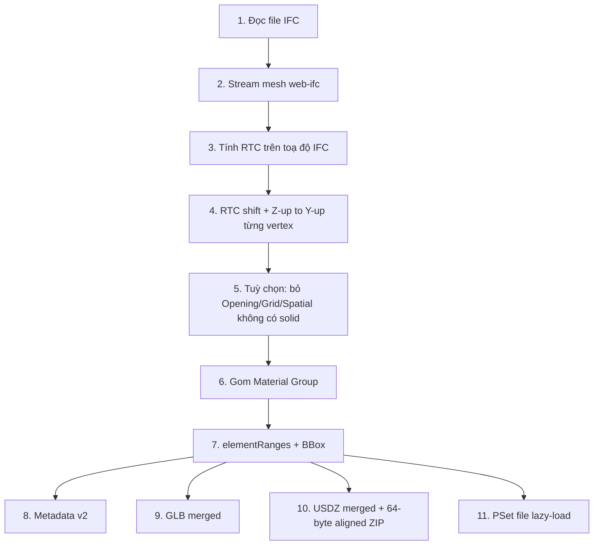

# Kế hoạch Kỹ thuật Chi tiết Phase 1: Backend Merge Mesh (IFC → USDZ / GLB / Metadata v2)

> **Mã dự án**: VJECT-AR / PA3 — repo `AR`  
> **Thư mục triển khai**: `backend/` (`d:\KietVu\Project\AR\backend`)  
> **Trạng thái**: **Đã triển khai Phase 1** (backend converter + upload)  
> **Phiên bản tài liệu**: 1.2 — 09/10/2026

---

## 1. Tổng quan & Mục tiêu

### 1.1. Bối cảnh & Vấn đề hiện tại
- **Thực trạng**: Pipeline Node (`src/utils/ifcConvert.js`) xuất **mỗi cấu kiện IFC = 1 mesh** trong GLB và USDZ. Với mô hình BIM thực tế (~2.000–~5.000 cấu kiện/bộ môn), USDZ chứa hàng nghìn `def Mesh`. Trên iOS (RealityKit / Quick Look), hàng nghìn draw call gây tụt FPS, spike RAM hoặc crash.
- **Mục tiêu Phase 1**: Chuyển pipeline sang **mỗi material group = 1 mesh**, kèm **Metadata v2** (`elementRanges`) và file PSet tách lazy-load (`<discipline>_psets.json`).
- **Kết quả kỳ vọng**:
  - Số mesh USDZ/GLB: từ ~2.000 xuống ~10–25/bộ môn (>98% draw calls).
  - Metadata v2 giữ tap / ẩn-hiện từng cấu kiện qua vertex/index range (client Phase 2).
  - PSet tách file → metadata chính gọn (< 5 MB).
  - **Toàn vẹn**: không mất cấu kiện/hình học; giữ `rtc_center_offset` và `length_unit_scale_to_meters` tương thích v1; thêm **64-byte ZIP alignment** cho USDZ (iOS mmap) — **chưa có trong code hiện tại, bắt buộc trong Task 3**.

### 1.2. Phạm vi phân định (Scope Boundary)
| Thuộc phạm vi Phase 1 (IN SCOPE) | Ngoài phạm vi Phase 1 (OUT OF SCOPE) |
|---|---|
| Merge mesh theo Material Group sau RTC + Y-up | UI ẩn/hiện/chọn cấu kiện (Phase 2 — admin/mobile) |
| `elementRanges` + BBox theo range | LOD / mesh decimation (Phase 3) |
| Metadata v2 + PSet file riêng | Worker pool / multi-tier cache (Phase 3) |
| `glbExport.js`, `usdzExport.js` theo `groups` | Đổi công thức RTC (vẫn 1 tâm/bộ môn, như `geometry.js` hiện tại) |
| `ifcConvert.js`, upload trong `bimModels.js` | Gom nhiều bộ môn vào 1 file USDZ/GLB |
| Unit/integration test + `validate_output.js` | Thay đổi schema DB `bim_models` (chỉ mở rộng `model_files` JSON nếu cần URL PSet) |

### 1.3. Liên kết hệ thống PA3 (ngoài converter)
- Upload IFC: `POST /api/v1/bim-models/upload-ifc` → `processIfcAtPath` → S3 `{prefix}/model.glb`, `model.usdz`, `metadata.json`, `source.ifc`.
- `bim_models.discipline_id` + bảng `disciplines` (migration `005_disciplines.sql`): code chuẩn `architecture`, `structure`, `plumbing`, `electrical`, `hvac`, `other` (`src/utils/disciplines.js`).
- Mobile offline: `GET /bim-models/:id/offline-manifest` — hiện trả `assets` + `element_styles`; sau Phase 1 nên bổ sung `metadata_url` / `psets_url` khi có trên S3.

---

## 2. Phân tích Hiện trạng Mã nguồn (`backend/`)

Khảo sát theo tree thực tế trong repo (không dùng path cũ `d:/vjectar_backend/ar`).

| Module | File | Hiện trạng |
|--------|------|------------|
| Geometry | `src/ifc/geometry.js` | `loadIfcMeshes(ifcData)` — `web-ifc` `StreamAllMeshes`, `buildMeshFromFlat`, màu qua `colors.js`. Tính `computeRtc` trên toạ độ IFC gốc; mỗi vertex qua `applyRtcAndYUp` (`src/ifc/utils.js`: trừ RTC rồi Z-up → Y-up). Trả về `{ meshes[], meshNames{}, rtcCenter, unitScale, modelID, api }` — **1 mesh / cấu kiện**. **Không** lọc Opening/Grid lúc stream (lọc spatial chỉ ở metadata). |
| Metadata | `src/ifc/metadata.js` | `extractMetadata` → **v1**: `{ elements[], summary }`; mỗi element có `id`, `global_id`, `mesh_name`, `properties` (PSet inline). Summary: `rtc_center_offset`, `length_unit_scale_to_meters`, `type_counts`, … |
| GLB | `src/ifc/glbExport.js` | `writeMeshesToGlb(meshes)` — 1 Node/Mesh/Primitive/cấu kiện; **không** normals accessor. |
| USDZ | `src/ifc/usdzExport.js` | `writeMeshesToUsdz(meshes)` — Xform gốc `BIMModel`, 1 `def Mesh` / cấu kiện; ZIP qua `archiver` `store: true`. **Chưa** 64-byte alignment; **chưa** PbrShader/Scope Materials. |
| Orchestration | `src/utils/ifcConvert.js` | `convertIfcToOutputs(ifcPath, workDir, baseName='model')` — **không** nhận `discipline`; output: `model.glb`, `model.usdz`, `model_metadata.json`. |
| API | `src/routes/bimModels.js` | Gọi convert với `baseName='model'`; upload `metadata.json`; DB `metadata` JSON chỉ giữ `description`, `summary`, preview URLs — **không** upload PSet riêng. |
| Hằng số | `src/ifc/constants.js` | `SPATIAL_CLASSES` (Opening, Grid, Site, …) dùng khi duyệt metadata, không khi build mesh. |

**Môi trường & kiểm thử**
- Node: ESM (`"type": "module"`), dependencies `web-ifc@0.0.77`, `@gltf-transform/core@4.x`, `archiver@8`.
- **Chưa** có `test/` hay script validate trong repo; **chưa** commit file `.ifc` mẫu — đặt tại `backend/test/fixtures/ifc/` (gitignore nếu file lớn) hoặc path local qua biến môi trường `IFC_FIXTURE_DIR`.

---

## 3. Kiến trúc Giải pháp & Pipeline Mới

### 3.1. Pipeline tuần tự 11 bước (bắt buộc)


> **Mấu chốt**: Bước 4 (RTC + Y-up **per vertex**, như hiện tại) **phải xong trước** bước 6. Gom group trước rồi mới shift sẽ lệch hình học giữa các cấu kiện.

### 3.2. Material Group & discipline
Mỗi group gom cấu kiện có cùng:
1. **`discipline`**: code từ upload (`resolveDisciplineId` / `disciplines.code`), không suy từ IFC.
2. **`ifcType`**: `typeName` web-ifc (vd. `IfcBeam`).
3. **`colorHex`**: `#RRGGBB` từ `mesh.color` (float RGB → hex, uppercase).

- Key logic: `<discipline>_<ifcType>_<colorHex>`  
- Key prim glTF/USD: `<discipline>_<ifcType>_<hexNoHash>` — regex `^[a-zA-Z_][a-zA-Z0-9_]*$` (dùng `sanitizeUsdName`).

Mã bộ môn hợp lệ trong DB: `architecture`, `structure`, `plumbing`, `electrical`, `hvac`, `other` (alias `struct`→`structure`, `mep`→`hvac`, … trong `normalizeDisciplineCode`).

### 3.3. Vertex Range Table (`elementRanges`)
Trong mỗi Material Group, buffer `positions` / `indices` (và **normals** nếu thêm ở Phase 1) ghép liên tục:
- `vertexOffset_k = sum(vertexCount_{0..k-1})`
- `globalIndex = localIndex + vertexOffset_k`

Mỗi phần tử range:
| Field | Ý nghĩa |
|-------|---------|
| `ifcId` | IFC `GlobalId` (trùng key v1 `elements[].id`) |
| `ifcType`, `name` | Loại & tên hiển thị |
| `vertexStart`, `vertexEnd` | [start, end) theo **số vertex** (bộ 3 float) |
| `indexStart`, `indexEnd` | [start, end) trong buffer indices |
| `bbox` | min/max trong **Y-up sau RTC** |

Ranges liên tục, không overlap: `vertexEnd_k === vertexStart_{k+1}`, tương tự indices.

### 3.4. Scene graph USDZ (mục tiêu)
```
def Xform "discipline_<code>"   # hoặc giữ defaultPrim có thể cấu hình
  Scope "Materials"
    Material "Mat_<hex>" ...
  def Mesh "<group.key>"       # 1 mesh / group
  ...
```

GLB: 1 `Node` + 1 `Mesh` + 1 `Primitive` / group (material theo `color`).

---

## 4. Đặc tả Hợp đồng Dữ liệu (Data Contracts)

### 4.1. Metadata v2 (`model_metadata.json` trên S3 — vẫn tên `metadata.json`)
```json
{
  "$schema": "./metadata_v2.schema.json",
  "version": 2,
  "discipline": "structure",
  "displayName": "Kết cấu tầng điển hình",
  "unitScale": 1.0,
  "rtcCenter": [2.510841692, -1.023123936, 18.000512315],
  "materialGroups": [
    {
      "key": "structure_IfcBeam_4CAF50",
      "discipline": "structure",
      "ifcType": "IfcBeam",
      "colorHex": "#4CAF50",
      "color": [0.298, 0.686, 0.314],
      "vertexCount": 12000,
      "indexCount": 24000,
      "elementRanges": [
        {
          "ifcId": "1_bWs7b3H5UfL5yBX6Si$P",
          "ifcType": "IfcBeam",
          "name": "B1-400x600:432101",
          "vertexStart": 0,
          "vertexEnd": 240,
          "indexStart": 0,
          "indexEnd": 480,
          "bbox": { "min": [-5.2, 3.1, -10.4], "max": [-1.2, 3.7, -9.8] }
        }
      ]
    }
  ],
  "elementsSummary": {
    "total_elements": 524,
    "elements_with_geometry": 524,
    "total_groups": 8,
    "total_vertices": 154200,
    "total_triangles": 98500,
    "type_counts": { "IfcBeam": 210, "IfcColumn": 120, "IfcSlab": 194 }
  },
  "psetsUrl": "structure_psets.json"
}
```

**Tương thích v1**
- `rtcCenter` = `summary.rtc_center_offset` (tâm bbox IFC **trước** shift, như code hiện tại).
- `unitScale` = `summary.length_unit_scale_to_meters`.
- Client cũ đọc `elements[]`: Phase 2 đọc `version`; nếu thiếu `version` hoặc `version === 1` → hành vi cũ.

**DB `bim_models.metadata`**: tiếp tục lưu subset (`summary`, `description`, URLs) — không nhét full `materialGroups` vào MySQL.

### 4.2. PSet lazy load (`<discipline>_psets.json`)
```json
{
  "version": 1,
  "discipline": "structure",
  "elements": {
    "1_bWs7b3H5UfL5yBX6Si$P": {
      "name": "B1-400x600:432101",
      "type": "IfcBeam",
      "properties": { "Pset_BeamCommon.LoadBearing": "True" },
      "psets": { "Pset_BeamCommon": { "LoadBearing": "True" } }
    }
  }
}
```

Logic trích xuất có thể tái sử dụng vòng lặp `IsDefinedBy` trong `extractMetadata`, gom theo `ifcId` thay vì nhúng vào metadata chính.

### 4.3. `model_files` (JSON trên bản ghi BIM)
Bổ sung sau upload (Task 5):
```json
{
  "glb_url": "...",
  "usdz_url": "...",
  "metadata_url": "...",
  "psets_url": ".../structure_psets.json",
  "metadata_version": 2
}
```

---

## 5. Danh sách Task Kỹ thuật Chi tiết

### Task 1: `src/ifc/geometry.js`
- **API mới**: `loadIfcMeshes(ifcData, { discipline = 'other' })` → `{ groups, meshNames, rtcCenter, unitScale, modelID, api, stats }`.
- Giữ stream + `buildMeshFromFlat`; sau bước Y-up, gom theo material key (mục 3.2).
- Merge buffer: `Float32Array` positions; `Uint32Array` indices; offset index khi append.
- **Tuỳ chọn khuyến nghị**: skip mesh nếu `SPATIAL_CLASSES.has(ifcType.toUpperCase())` hoặc `indices.length < 3`.
- Helper: `rgbToHex(color: number[])` → `#RRGGBB`.
- Deprecation: export wrapper `meshesFromGroups(groups)` cho test so sánh v1 nếu cần.

### Task 2: `src/ifc/metadata.js`
- `buildMetadataV2({ groups, rtcCenter, unitScale, discipline, displayName, psetsUrl })`.
- `extractPsetsMap(api, modelID, validGlobalIds)` → object keyed by GlobalId.
- `writeMetadataV2(path, payload)` + `writePsetsFile(path, payload)`.
- Giữ `extractMetadata` (v1) cho script migration hoặc xóa sau khi client chuyển hết v2.

### Task 3: `src/ifc/usdzExport.js`
- `writeMeshesToUsdz(groups, usdzPath, { discipline, defaultPrim })`.
- 1 `def Mesh` / group; Materials scope + binding.
- **Implement** `create64ByteAlignedUsdz(usdaLocalName, usdaBuffer)` (Apple uncompressed ZIP, offset % 64 === 0) — thay `archiver` store-only hiện tại cho file `.usdz` production.
- Unit test kiểm tra số `def Mesh` và alignment.

### Task 4: `src/ifc/glbExport.js`
- `writeMeshesToGlb(groups, outPath)` — 1 node/mesh/group; cân nhắc thêm NORMAL accessor (tính flat hoặc từ IFC nếu có sau này).

### Task 5: `src/utils/ifcConvert.js` & `src/routes/bimModels.js`
- `convertIfcToOutputs(ifcPath, workDir, baseName, { discipline, displayName })`:
  1. `loadIfcMeshes(..., { discipline })`
  2. GLB + USDZ + metadata v2 + `{discipline}_psets.json`
  3. Return `{ glbPath, usdzPath, metadataPath, psetsPath, metadataVersion: 2 }`
- `processIfcAtPath`: resolve `discipline_code` từ `disciplineId` (JOIN `disciplines`) → truyền vào convert; upload PSet lên S3; set `model_files.psets_url`.
- `offline-manifest`: thêm `metadata_url`, `psets_url`, `metadata_version` nếu có.

### Task 6: Test & validation
- `backend/test/unit/geometryGroup.test.js` — Node native `node:test` (thêm `"test": "node --test test/**/*.test.js"` vào `package.json`).
- `metadataV2.test.js`, `usdzAligned.test.js`.
- `backend/scripts/validate_output.js` — CLI: `--dir <workDir>` kiểm tra version, mesh count, range continuity, unique `ifcId`.

**Fixtures gợi ý** (tự thu thập, không có trong repo):
| Nhãn | Quy mô gợi ý |
|------|----------------|
| small | ~500 elements / ~20 meshes |
| medium | ~2k elements |
| large | ~5k elements |

---

## 6. Edge Cases & Rủi ro

| Edge case | Xử lý |
|-----------|--------|
| 1 cấu kiện | 1 group, 1 range |
| Không màu IFC | Fallback `colors.js` / `DEFAULT_COLOR` |
| Cùng type, khác màu | Tách group |
| Không geometry | `throw` / `AppError('NO_GEOMETRY')` tại convert |
| Trùng GlobalId | Warning + suffix `_dupN` trên `ifcId` metadata |
| Vertex/index rỗng | Skip + log |
| Toạ độ lớn | RTC như hiện tại |
| Ký tự lạ trong prim name | `sanitizeUsdName` |

| Rủi ro | Mức | Giảm thiểu |
|--------|-----|------------|
| Lệch RTC giữa groups | Cao | Shift Y-up **trước** merge; một `rtcCenter`/file |
| Sai index offset | Cao | Unit test công thức offset |
| USDZ không mở trên iOS | Cao | 64-byte ZIP + test offset |
| Metadata quá lớn | TB | PSet tách file |
| Thời gian convert | Thấp | TypedArray merge; mục tiêu ≤120% v1 |

---

## 7. Tiêu chí Nghiệm thu

| Tiêu chí | Cách đo | Ngưỡng |
|----------|---------|--------|
| Mesh USDZ/GLB | Đếm `def Mesh` / glTF nodes | < 100 (kỳ vọng 10–25) @ ~5k cấu kiện |
| Material groups | `materialGroups.length` | 5–25 / bộ môn |
| Mất cấu kiện | Set `ifcId` vs geometry | 0 |
| Mất vertex/index | Sum group vs raw | 0 |
| Unique `ifcId` | Set size | 100% |
| Range overlap | Script validate | 0 |
| RTC / unitScale | So v1 cùng IFC | Khớp |
| 64-byte alignment | ZIP parse | offset % 64 === 0 |
| Metadata v2 size | File size | < 5 MB (không tính PSet) |
| Convert time | Wall clock vs v1 | ≤ 120% |

---

## 8. Lộ trình triển khai

```
[Bước 1] geometry.js — groups + tests offset/bbox
[Bước 2] metadata.js — v2 + psets + schema JSON
[Bước 3] usdzExport.js — merged + 64-byte ZIP
[Bước 4] glbExport.js — merged groups
[Bước 5] ifcConvert.js + bimModels.js + offline-manifest
[Bước 6] validate_output.js + 3 fixture IFC
[Bước 7] docs: METADATA_V2.md, MIGRATION_GUIDE.md, PHASE1_CHANGES.md
```

---

## 9. Deliverables Phase 1

1. **Mã nguồn**
   - `src/ifc/geometry.js`, `metadata.js`, `usdzExport.js`, `glbExport.js`
   - `src/utils/ifcConvert.js`, `src/routes/bimModels.js`
2. **Schema & docs** (under `backend/docs/`)
   - `metadata_v2.schema.json`
   - `METADATA_V2.md`, `MIGRATION_GUIDE.md`, `PHASE1_CHANGES.md`
3. **Test & scripts**
   - `test/unit/*.test.js`
   - `scripts/validate_output.js`
4. **Sample outputs** (artifact CI hoặc thư mục nội bộ, không bắt buộc commit)
   - `{small|medium|large}/model.glb`, `model.usdz`, `metadata.json`, `<discipline>_psets.json`

---

## Phụ lục A — So sánh nhanh v1 → v2

| Khía cạnh | v1 (hiện tại) | v2 (Phase 1) |
|-----------|---------------|--------------|
| GLB/USDZ meshes | 1 / cấu kiện | 1 / material group |
| `metadata.json` | `elements[]` + PSet inline | `materialGroups[]` + `psetsUrl` |
| USDZ ZIP | archiver store | 64-byte aligned uncompressed |
| Upload API | 3 file 3D + meta | + `psets.json`, `metadata_version` |
| `loadIfcMeshes` args | `(ifcData)` | `(ifcData, { discipline })` |
